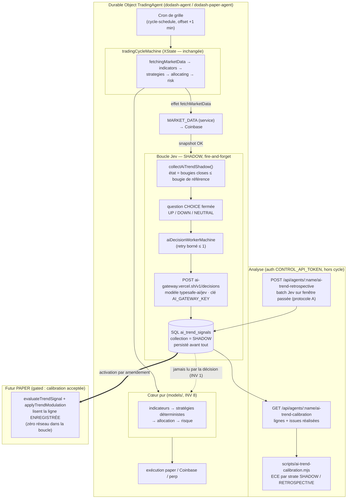

# Flux du signal de tendance IA (Jev) — schéma de fonctionnement

Schéma normatif d'implémentation de `models/ai-trend-signal.md` (état :
SHADOW). Jev vit dans une **branche latérale** du cycle : il produit des
signaux typés persistés, jamais consommés par la décision (INV 1,
`decision-core.md` INV 5 amendé).

## Pourquoi aucun appel Jev dans la chaîne de décision

1. `decision-core.md` INV 5 (amendé 2026-10-30) : le signal IA ne peut que
   **moduler** la confiance des signaux des stratégies déterministes, dans
   `[1, maxFactor]` — jamais originer, jamais inverser, jamais déclencher de
   transition.
2. Le cœur pur ne consomme que le **type enregistré** `AiTrendSignal`
   (persisté avant consommation, pattern `clientOrderId`) : le backtest
   rejoue ces lignes avec exactement les mêmes fonctions (INV 8).
3. Activation `SHADOW → PAPER` uniquement après rapport de calibration
   accepté ; `LIVE` interdit sans nouvel amendement.

## Où trouver chaque pièce

| Rôle | Fichier |
|---|---|
| Appel HTTP gateway (Jev / OpenAI Decisions) | `apps/agent/src/ai-decision-gateway.ts` |
| Machine du port (validation, retry borné, codes fermés) | `models/ai-decision-worker.machine.ts` |
| Collecte SHADOW après fetch marché | `apps/agent/src/ai-trend-producer.ts` + `trading-agent.ts#collectAiTrendShadow` |
| Point d'accroche (aucun impact sur la phase machine) | `trading-effects.ts#onMarketDataFetched` |
| Collecte rétrospective (protocole A) | `apps/agent/src/ai-trend-retrospective.ts` |
| Jointure issue + lecture calibration | `apps/agent/src/ai-trend-calibration.ts` |
| ECE + courbe de fiabilité (pur) | `models/ai-trend-signal.ts#computeTrendCalibration` |
| Rapport stratifié | `apps/agent/scripts/ai-trend-calibration.mjs` |
| Signal persisté | table DO `ai_trend_signals` (1 ligne / produit × bougie, provenance `collection`) |

## Cadence et coûts (grille ONE_HOUR)

- Collecte B (SHADOW) : 1 appel Jev par produit et par heure, au cycle
  ~:01 ; refus/échec ⇒ aucune ligne, aucune alerte bloquante.
- Collecte A (rétrospective) : sur commande, ≤ 48 bougies par appel.
- Coût marginal ≈ 1,7e-5 $/appel (BYOK) : une journée = ~0,0004 $/produit.
